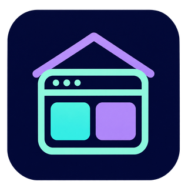

# PWA Web-App Studio



[English](README.md) | **Deutsch**

Mit PWA Web-App Studio erstellen Administratoren installierbare Web-Apps aus Lovelace-Dashboards oder ausgewählten Karten. Jede App hat eine eigene URL, ein Icon und eigene Freigaben.

## Ersten Entwurf ausprobieren

1. Kopiere `custom_components/pwa_app_studio/` in den Ordner `custom_components/` einer Home-Assistant-Testinstallation.
2. Starte Home Assistant neu und füge **PWA Web-App Studio** unter **Einstellungen > Geräte & Dienste > Integration hinzufügen** hinzu.
3. Öffne **PWA Web-App Studio** in der Seitenleiste, wähle ein Dashboard oder füge Karten hinzu und speichere die App.
4. Öffne den Installationslink oder QR-Code auf einem Gerät, das Home Assistant über HTTPS erreicht.

Die App verwendet das angemeldete Home-Assistant-Konto. Für ein Dashboard gelten weiterhin dessen Berechtigungen in Home Assistant. Der Offline-Cache speichert die App-Hülle und statische Dateien. Lovelace-Inhalte brauchen eine Verbindung zu Home Assistant.


## Start, Freigabe und Sitzung

- **App → Animation beim Öffnen** bietet sanfte Wellen, einen Leuchtschein und ein Standbild. Das Startbild verwendet das App-Symbol und die gewählten Farben. Die Systemoption für reduzierte Bewegung wird berücksichtigt.
- **Zugriff → Gäste im Heimnetz** lässt dich einzelne Konten ohne Administratorrechte mit „Nur lokaler Zugriff“ freigeben. Der QR-Code nutzt die interne Home-Assistant-Adresse. Das Gastkonto behält seine übrigen Rechte in Home Assistant.
- **Teilen** bietet den Companion-Link und den QR-Code zur Installation der Web-App.

## In der Companion-App anmelden und die erstellte App öffnen

1. Öffne auf dem Handy die offizielle **Home Assistant**-App. Falls dein Server dort noch fehlt, tippe auf **Mit meinem Home-Assistant-Server verbinden** oder unter **Einstellungen → Companion-App** auf **Server hinzufügen**. Wähle die richtige Instanz aus oder trage ihre Adresse ein. Gib Benutzername, Passwort und gegebenenfalls den zweiten Faktor im Anmeldefenster der Companion-App ein. Sobald du dein Home-Assistant-Dashboard siehst, bist du angemeldet. [Einrichtung der Companion-App](https://companion.home-assistant.io/docs/getting_started/#step-by-step-setup)
2. Öffne als Administrator **PWA Web-App Studio** in der Home-Assistant-Seitenleiste. Wähle deine App, prüfe unter **Zugriff** die Freigabe für das Konto auf dem Handy und speichere. Öffne **Teilen**.
3. Tippe auf dem Handy auf **In Home Assistant öffnen**. Wenn der Designer auf einem anderen Gerät geöffnet ist, verwende **Companion-Link kopieren** und teile den Link mit dem Handy. Öffne ihn dort und wähle bei mehreren Servern die Instanz mit dieser App. Die Ansicht öffnet sich mit der aktiven Sitzung in Home Assistant. [Companion-Navigationslinks für Android und iOS](https://companion.home-assistant.io/docs/integrations/url-handler/#navigate)

### Für Gäste im Heimnetz

1. Erstelle unter **Einstellungen → Personen → Benutzer** ein Konto mit Anmeldung und **Nur lokaler Zugriff**. Lasse **Administrator** deaktiviert. [Home Assistant Benutzerverwaltung](https://www.home-assistant.io/docs/configuration/user-configuration/)
2. Wähle im Studio **Zugriff → Gäste im Heimnetz**, markiere das Konto und speichere. Wenn du das Konto gerade erstellt hast, verwende **Konten neu laden**.
3. Der Gast verbindet sein Handy mit deinem Heim-WLAN und fügt deine **interne Home-Assistant-Adresse** in seiner Companion-App hinzu. Er meldet sich dort einmal mit dem Gastkonto an und öffnet den Companion-Link für deine Instanz.

### Direkt vom Home-Assistant-Dashboard starten

Wenn dein Messenger den Companion-Link als Text anzeigt oder du einen festen Einstieg im Dashboard möchtest, öffne im Studio **Teilen → Link und Dashboard-Pfad anzeigen**. Kopiere den relativen Pfad und lege als Administrator auf einem Dashboard, das das Konto öffnen darf, eine **Schaltflächenkarte** an. Wähle als Tipp-Aktion **Navigieren** und trage den Pfad ein. [Dashboard-Aktionen in Home Assistant](https://www.home-assistant.io/dashboards/actions/)

```yaml
type: button
name: Mein Garten öffnen
icon: mdi:cellphone
tap_action:
  action: navigate
  navigation_path: /pwa-app-studio-runner/mein-garten
```

Der QR-Code und **Auf diesem Gerät installieren** öffnen die eigenständige Browser-Web-App. Diese verwendet die Sitzung des jeweiligen Browsers und zeigt die Home-Assistant-Anmeldung, wenn dort noch keine Sitzung vorhanden ist.

Die Mindestversion von Home Assistant Core ist **2021.12.0** (HACS-Metadaten). Auf älteren Core-Versionen bietet der Designer eine Schaltflächenkarte an, wenn die Tile-Karte noch nicht verfügbar ist. Für die Installation der PWA selbst ist ein aktueller Browser erforderlich.

[Architekturprüfung](docs/architekturpruefung.md)
