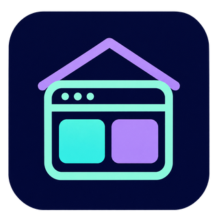

<!-- header:begin (generated from project metadata) -->
<h1 align="center">PWA Web-App Studio</h1>

<p align="center">
  <a href="https://my.home-assistant.io/redirect/hacs_repository/?owner=seb5594&amp;repository=hass-pwa_app_studio-integration&amp;category=integration"></a>
  <a href="https://github.com/seb5594/hass-pwa_app_studio-integration/actions/workflows/compat.yml"></a><br>
  <a href="https://github.com/seb5594/hass-pwa_app_studio-integration/releases/tag/2026.11.26.8"></a>
  <a href="https://github.com/seb5594/hass-pwa_app_studio-integration/releases"></a><br>
  <a href="https://github.com/seb5594/hass-pwa_app_studio-integration/actions/workflows/ci.yml"></a>
  
  <a href="https://github.com/seb5594/hass-pwa_app_studio-integration/issues"></a><br>
  <a href="https://paypal.me/seb5594"></a>
  <a href="https://buymeacoffee.com/seb5594"></a><br>
  <a href="https://github.com/seb5594/hass-pwa_app_studio-integration#license"></a>
</p>
<!-- header:end -->

<p align="center"></p>

**🇬🇧 English** · [🇩🇪 Deutsch](README.de.md)

Want a kitchen dashboard on a wall tablet, a garden view on your phone, or a few controls for visitors? PWA Web-App Studio turns an existing Home Assistant dashboard or a selection of Lovelace cards into a web app. Each app gets its own link, icon, colors and access settings.

## Installation

You need **Home Assistant Core 2021.12.0 or later** and an administrator account for the designer. The Home Assistant version controls which cards are available. For example, older installations get a button card in place of the Tile preset.

### Marketplace or HACS

1. On Home Assistant 2026.11 and newer, open **Settings → Marketplace**. On earlier versions, open **HACS** if it is installed.
2. Search for **PWA Web-App Studio**, or use the **HACS · Marketplace** badge above. If it is missing from the catalog, add `https://github.com/seb5594/hass-pwa_app_studio-integration` via **Add from link** in the Marketplace or **Custom repositories** in HACS. Connect GitHub if the Marketplace asks and select **Integration** if prompted for a type. [Marketplace help](https://www.home-assistant.io/integrations/marketplace/#custom-repositories) · [HACS custom repositories](https://hacs.xyz/docs/faq/custom_repositories/)
3. Select **Install** in the Marketplace and complete the setup form when it opens. In HACS, download the integration, restart Home Assistant, then go to **Settings → Devices & services → Add integration** and select **PWA Web-App Studio**.

### Install from the ZIP

1. Download `pwa_app_studio.zip` from the [latest release](https://github.com/seb5594/hass-pwa_app_studio-integration/releases/latest).
2. Extract its contents into `custom_components/pwa_app_studio/` inside your Home Assistant configuration directory. You should end up with `custom_components/pwa_app_studio/manifest.json`.
3. Restart Home Assistant and add **PWA Web-App Studio** under **Settings → Devices & services → Add integration**.

Keep the administrator sidebar option enabled for quick access. You can also reach the designer at `/pwa-app-studio` on your Home Assistant server.

## Build your first app

Open **PWA Web-App Studio** and select **+ New web app**. The designer uses English by default and switches to German when the Home Assistant system language under **Settings → System → General** is German. Older servers that only expose the frontend language use that setting instead.

1. **App**. Enter a name and a short name for the home screen. Pick an accent and background color. New apps start with blue (`#2563EB`). Choose a **Launch animation** to see it with your colors and icon. The preview has a **Replay animation** button. Choose **Still image** to turn off animation for the app.
2. **Content**. Choose a dashboard and, if you like, a specific view. For a smaller app, assemble individual cards and choose their layout.
3. **Icon**. Use a Home Assistant or dashboard icon, choose an MDI icon, or upload an image. The preview can show a phone, tablet or desktop layout.
4. **Access**. Pick who can open the app. Choose all signed-in users, selected accounts, local guests or administrators. Save with **Save**.
5. **Share**. Open the app in the Companion App, copy its link or use the QR code for the browser version.

Each app uses the permissions of the signed-in Home Assistant account. Keep that in mind when choosing a dashboard for someone else.

## Open it in the Home Assistant Companion App

1. Open the official **Home Assistant** app on your phone. If your server is already signed in, check that you can see its dashboard. Otherwise select **Connect to my Home Assistant server**, or **Settings → Companion App → Add Server** on an existing setup. Pick or enter your server address and sign in inside the app. [Companion App setup](https://companion.home-assistant.io/docs/getting_started/#step-by-step-setup)
2. In the designer, open the saved app and go to **Share → Open in Home Assistant**. If you are at your computer, select **Copy Companion link** and send the link to your phone.
3. Tap the link and choose the correct server if prompted. The app view opens with the active Companion session. [Android and iOS navigation links](https://companion.home-assistant.io/docs/integrations/url-handler/#navigate)

### Add a dashboard button

Want a fixed place to open the app? Under **Share → Show the link and dashboard path**, copy the dashboard path. Add a button card to a dashboard the account can open, select **Navigate** as its tap action and paste the path. For an app with the slug `my-garden`, the YAML looks like this. [Home Assistant dashboard actions](https://www.home-assistant.io/dashboards/actions/)

```yaml
type: button
name: Open My Garden
icon: mdi:cellphone
tap_action:
  action: navigate
  navigation_path: /pwa-app-studio-runner/my-garden
```

## Share with guests on your home network

1. In Home Assistant, go to **Settings → People → Users**. Create an account, turn on **Local access only** and leave **Administrator** off. [Home Assistant user accounts](https://www.home-assistant.io/docs/configuration/user-configuration/#about-persons-and-users)
2. In the studio, choose **Access → Guests on the home network**. Select the guest account and save. If you created it while the designer was open, select **Reload accounts** to refresh the list.
3. The guest joins your home Wi-Fi, adds your internal Home Assistant address in the Companion App and signs in with the guest account. Share the Companion link or give them the dashboard button.

For browser sharing, the guest-mode QR code uses the internal Home Assistant address. If the QR code is unavailable, check the internal URL under **Settings → System → Network** and make sure the guest device can reach that address.

## Install the browser web app

1. On Android, select **Open in Chrome to install** under **Share**. If the phone keeps the page inside Home Assistant, select **Copy browser link**, launch Chrome itself and paste the link into its address bar. On other devices, use **Install on this device**. The target device needs an HTTPS address with a valid certificate.
2. Sign in to Home Assistant if the browser asks. On iPhone or iPad, open the link in Safari and use **Share → Add to Home Screen**. Turn on **Open as Web App** if it is shown. On Android, choose **Install now** if Chrome offers the prompt. Otherwise choose **⋮ → Install and create shortcut → Install** in Chrome. The wording can vary by browser version. On desktop, use the install option in a browser that offers it. [Apple instructions](https://support.apple.com/guide/iphone/iphea86e5236/ios) · [Chrome instructions](https://support.google.com/chrome/answer/9658361)
3. Tap the icon on your home screen to open the app. A standalone web app uses its browser session. If that session is missing, Home Assistant prompts you to sign in.

**Share link** opens your device’s sharing menu. **Copy browser link** gives you the same URL as the QR code.

Offline caching covers the app shell, icon and other public files. Cards, current states and device controls need a connection to Home Assistant.

## Questions or something not working?

- **Access denied.** Check which Home Assistant account is signed in and whether it is selected under **Access**. For guests, also check that the phone is using your internal server address from your home network.
- **The Companion link stays as text.** Use a dashboard button with the relative path from the designer.
- **The install option is missing.** Open the browser link in Safari on Apple mobile devices or an install-capable Chromium browser. Check that the HTTPS URL opens without a certificate error.
- **A card is missing.** Check it first in Home Assistant with the same account. If it is a custom card, check that its resource is available to that frontend.

If you are still stuck, include your Core version, Studio version, device and the steps that reproduce the issue. [Report an issue](https://github.com/seb5594/hass-pwa_app_studio-integration/issues) · [Changelog](CHANGELOG.md) · [Architecture notes in German](docs/architekturpruefung.md)

<!-- support:begin (generated, shared text) -->
## Say thanks

All my projects are built in my spare time, just for the fun of it. Still, they take a lot of time and care, and many of the smart home gadgets I buy end up here because I want to make them cloud-free and smart-home ready. Every bit of support means a lot to me.

If my work helped you or turned out to be useful, show your appreciation with a hot drink for my next sleepless night.

[](https://paypal.me/seb5594) [](https://buymeacoffee.com/seb5594)
<!-- support:end -->

<!-- license:begin (generated from the license file) -->
## License

[](LICENSE)

Published under the [Apache License 2.0](LICENSE).
<!-- license:end -->
